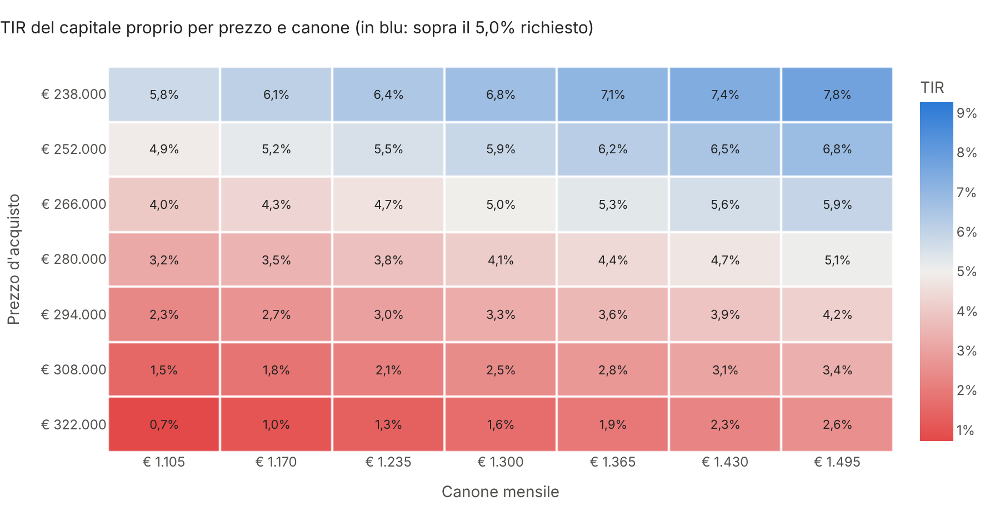
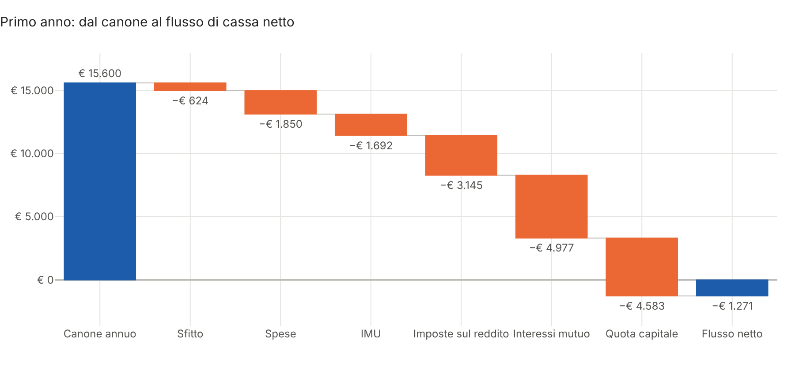
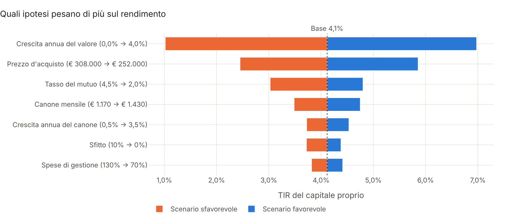
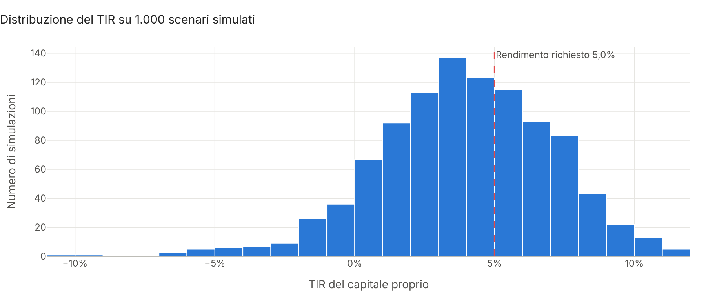

# Real Estate Analyzer

**Valutazione di investimenti immobiliari per la gestione patrimoniale, in Python.**

Date le ipotesi su un immobile da mettere a reddito (prezzo, canone, spese, mutuo, regime fiscale), il
progetto proietta i flussi di cassa anno per anno, applica la **fiscalità italiana** (imposte d'acquisto,
IMU, cedolare secca o IRPEF), calcola VAN, TIR, cap rate e prezzo massimo d'offerta, misura quanto il
risultato dipende dalle ipotesi e produce un **report HTML interattivo pronto da consegnare al cliente**.



## Cosa fa

| Area | Contenuto |
|---|---|
| **Acquisto** | Imposta di registro sul valore catastale (prezzo-valore) o IVA da impresa, agenzia, notaio, lavori, arredo |
| **Mutuo** | Piano di ammortamento alla francese mensile, imposta sostitutiva, rimborso del debito residuo alla vendita |
| **Fiscalità** | IMU, cedolare secca 21% / 10% concordato, IRPEF ordinaria sul 95% del canone con registro, plusvalenza entro 5 anni |
| **Flussi di cassa** | Canone indicizzato, sfitto, spese indicizzate all'inflazione, NOI, flusso netto dopo imposte e rata |
| **Indicatori** | Rendimento lordo e netto, cap rate, cash-on-cash, DSCR, VAN, TIR con e senza leva, moltiplicatore del capitale, occupazione di pareggio |
| **Valutazione** | Valore DCF dei flussi e **prezzo massimo d'offerta** che azzera il VAN al rendimento richiesto |
| **Sensitività** | Griglia prezzo × canone, tornado sulle ipotesi chiave, scenari a confronto, simulazione Monte Carlo |
| **Report** | HTML in italiano con grafici interattivi Plotly, tabella dei flussi, esito in linguaggio semplice |

I calcoli finanziari usano `numpy-financial`, le tabelle `pandas`, i grafici `plotly`. Ogni regola fiscale è
una funzione separata e testata, così è facile verificarla o aggiornarla quando cambia la normativa.

## Avvio rapido

```bash
git clone https://github.com/Torraf-MI/real-estate-analyzer.git
cd real-estate-analyzer
pip install -e ".[png]"

# Report sull'esempio dimostrativo (bilocale a Milano)
real-estate-analyzer --demo --cliente "Mario Rossi"

# Report da un file di ipotesi, autonomo anche senza connessione
real-estate-analyzer --config examples/trilocale_torino.toml --cliente "Famiglia Bianchi" --offline

# Varianti al volo: altro prezzo, acquisto in contanti, regime ordinario
real-estate-analyzer --demo --prezzo 265000 --senza-mutuo --regime ordinario --grafici output/img
```

Il report viene salvato in `output/report.html`. Due esempi già generati:
[bilocale a Milano](docs/report_esempio.html) (investimento sotto l'obiettivo) e
[trilocale a Torino](docs/report_torino.html) (investimento che crea valore).

Le ipotesi si scrivono in un file TOML leggibile anche da chi non programma:

```toml
nome = "Trilocale Torino, zona San Salvario"

[acquisto]
prezzo = 160000
rendita_catastale = 780
ristrutturazione = 12000

[locazione]
canone_mensile = 980
canone_concordato = true
regime = "cedolare"

[mutuo]
ltv = 0.70
tasso = 0.031
durata_anni = 20

[scenario]
orizzonte = 12
tasso_sconto = 0.05
```

## Uso come libreria

```python
from real_estate_analyzer import calcola, esempio_milano, prezzo_massimo, proiezione
from real_estate_analyzer.sensitivita import griglia, tornado

inv = esempio_milano()
print(proiezione(inv)[["Canone incassato", "NOI", "Imposte sul reddito", "Rata", "Flusso netto"]])

ind = calcola(inv)
print(ind["TIR"], ind["VAN"], ind["Cap rate"])

# Cosa cambia pagando in contanti o con l'IRPEF al 43%?
print(calcola(inv.con(mutuo__ltv=0))["TIR"])
print(calcola(inv.con(locazione__regime="ordinario", locazione__aliquota_irpef=0.43))["TIR"])

print(prezzo_massimo(inv))      # prezzo oltre il quale il VAN diventa negativo
print(griglia(inv, "TIR"))      # sensitività prezzo × canone
```

Esempio completo in [`examples/esempio.py`](examples/esempio.py) e percorso guidato nel notebook
[`notebooks/demo.ipynb`](notebooks/demo.ipynb).

## Risultati sull'esempio dimostrativo

Bilocale a Milano da 280.000 €, 20.000 € di lavori, canone di 1.300 € al mese in cedolare secca, mutuo al 60%
a 25 anni, vendita dopo 10 anni. Il cliente chiede almeno il 5% annuo sul capitale proprio.

| Indicatore | Valore |
|---|---|
| Capitale proprio necessario | € 168.581 |
| Rendimento lordo / netto | 5,6% / 2,5% |
| Cap rate | 3,6% |
| TIR del capitale proprio | 4,1% |
| VAN al 5% | −€ 13.905 |
| **Prezzo massimo d'offerta** | **€ 265.593** |

Nel primo anno il canone non copre spese, imposte e rata: il flusso netto è negativo di circa 100 € al mese.



Il rendimento dipende soprattutto dalla rivalutazione dell'immobile e dal prezzo pagato, molto più che dal
canone o dallo sfitto: la trattativa sul prezzo è la leva più concreta.



La simulazione Monte Carlo fa variare insieme canone, sfitto, crescita e tasso del mutuo: l'obiettivo del 5%
è raggiunto in circa un terzo degli scenari.



## Metodologia in breve

- **Imposte d'acquisto**: da privato, registro al 9% (2% prima casa) sul valore catastale, cioè rendita × 1,05 ×
  120 (110 prima casa), minimo 1.000 €, più 50 + 50 € di ipotecaria e catastale. Da impresa, IVA al 10% (4% prima
  casa) e imposte fisse di 200 €.
- **IMU**: rendita × 1,05 × 160 × aliquota comunale, ridotta del 25% per i contratti a canone concordato.
- **Imposte sul reddito**: cedolare secca al 21% (10% a canone concordato) sul canone incassato, oppure IRPEF
  marginale più addizionali sul maggiore tra 95% del canone (ridotto di un ulteriore 30% se concordato) e rendita
  rivalutata, più metà dell'imposta di registro del contratto (1% del canone).
- **Mutuo**: rata costante mensile, interessi e capitale aggregati per anno; il debito residuo viene estinto
  alla vendita. Imposta sostitutiva del 2% (0,25% prima casa).
- **Vendita**: valore di mercato rivalutato al tasso ipotizzato meno i costi di vendita; plusvalenza tassata al
  26% solo se si vende entro cinque anni.
- **VAN e TIR** sui flussi del capitale proprio. Il **prezzo massimo d'offerta** si trova per bisezione: è il
  prezzo che azzera il VAN, ricalcolando imposte, provvigioni e mutuo ma lasciando invariato il valore di
  mercato dell'immobile. Il **valore DCF** è il valore attuale dei flussi senza leva.

## Struttura

```
src/real_estate_analyzer/
├── modello.py      # ipotesi dell'investimento (dataclass) e lettura da TOML
├── fiscale.py      # imposte d'acquisto, IMU, cedolare/IRPEF, plusvalenza
├── mutuo.py        # piano di ammortamento alla francese
├── flussi.py       # costo iniziale e proiezione annua dei flussi
├── metriche.py     # VAN, TIR, cap rate, DSCR, valore DCF, prezzo massimo
├── sensitivita.py  # griglia, tornado, scenari, Monte Carlo
├── report.py       # grafici Plotly e report HTML
├── cli.py          # riga di comando
└── templates/      # modello del report
examples/           # file TOML di esempio e uso come libreria
notebooks/          # notebook dimostrativo
tests/              # 29 test (pytest), eseguiti a ogni push con GitHub Actions
```

## Test

```bash
pip install -e ".[dev]"
pytest
```

I test verificano le regole fiscali su casi calcolati a mano (registro sul valore catastale, minimo di 1.000 €,
IMU, cedolare e IRPEF), la rata del mutuo con la formula chiusa, che il VAN sia nullo al TIR, che il prezzo
massimo azzeri davvero il VAN e che la sensitività sia monotona (prezzo più alto, TIR più basso).

## Avvertenze

Gli esempi usano valori plausibili ma **non si riferiscono a immobili reali**. La fiscalità è modellata in forma
semplificata per una persona fisica che possiede abitazioni non di lusso; aliquote e agevolazioni cambiano nel
tempo e da comune a comune, quindi vanno verificate con un commercialista. Il progetto ha scopo dimostrativo e
non costituisce consulenza finanziaria, fiscale o legale.

## Licenza

MIT. Autore: Francesco Torraco.
